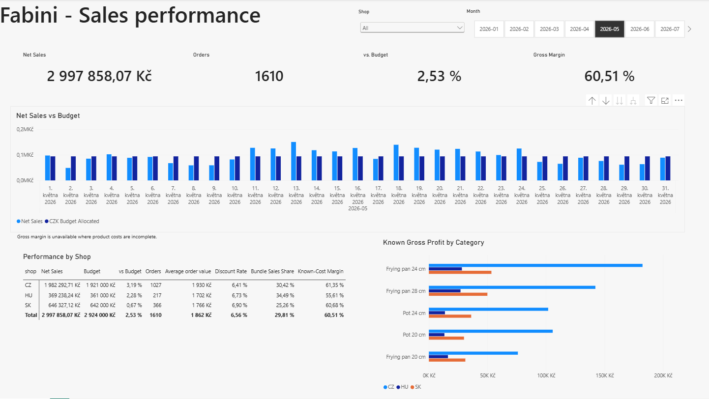

# FABINI Data & BI Case Study

This project models six sales CSV sources with dbt Core and DuckDB, answers four management questions, and delivers a one-page Power BI dashboard.

## Data flow

```text
raw_data/*.csv
  -> dbt sources (S0)
  -> typed SQL staging views (S1)
  -> intermediate sales tables (S2)
  -> fact_sales and fact_daily_metrics (S3)
  -> exports/*.csv
```

The root directory is the only dbt project. The six CSVs are read directly by DuckDB; no notebook staging or generated Parquet files are required. The eight SQL data-quality tests run with `dbt build`.

## Run the pipeline

Install the local dependencies with `pip install -r requirements.txt`, then run from the repository root:

```shell
dbt build --profiles-dir .
```

The isolated DuckDB database is `fabini_dbt.duckdb`. Both CSV exports are written to `exports/`. To check completed exports:

```shell
python scripts/validate_results.py
```

Optional previously validated standalone exports can be compared with:

```shell
python scripts/validate_results.py --reference-sales path/to/fact_sales.csv --reference-daily path/to/fact_daily_metrics.csv
```

The validator treats `\N` as NULL and preserves empty strings and zero as distinct values; reference exports must use the same NULL token for exact comparison. Without both reference files, it reports **PARTIAL VALIDATION**. It reads completed CSV files only; it does not run or rebuild dbt.

The [dbt-ci.yml](.github/workflows/dbt-ci.yml) workflow runs manually from GitHub Actions. It installs `dbt-duckdb`, builds and tests the project, verifies both exports, and uploads them for seven days.

## Analysis and limitations

Four management SQL analyses are in `analysis/`; the Task 1 source-exploration notebooks are in `analysis/exploration/`. Results are summarized in [answers.md](answers.md).

Business calculations preserve VAT rates of 21% (CZ), 23% (SK), and 27% (HU), use the latest FX rate on or before the Prague reporting date, exclude cancelled lines, and allocate bundle sales by component cost share. Gross sales and discounts are rounded separately to CZK cents before net sales. Missing costs remain NULL.

The reporting period is January–September 2026. Lines dated September 30 UTC can report as October 1 in Prague and are treated as spillover, not Q3. Four SKUs are absent from the product catalog, leaving 277 sales rows without known costs; total COGS and margin are incomplete.

## Power BI Dashboard

The one-page Power BI dashboard supports the CEO's Monday sales review. Shop and Month slicers enable analysis across markets and reporting periods.

KPI cards summarize Net Sales, Orders, budget variance, and Gross Margin for the selected context. The daily Net Sales vs Budget chart compares actual revenue with the monthly budget evenly allocated across calendar days. The Performance by Shop matrix compares sales, budget, orders, average order value (AOV), discount rate, bundle-sales share, and Known-Cost Margin. The category bar chart highlights known gross profit by product category and shop.

Daily budget allocation is an analytical assumption, not a daily forecast. Products with missing costs are excluded from known-cost profitability calculations, so margin figures do not represent complete product-cost coverage.



Open the [Power BI project](exports/Dashboard.pbip) in Power BI Desktop.

## Validation status

The dbt-only GitHub Actions run completed with **20 PASS, 0 ERROR**, including the eight SQL tests. Local validation of the generated CSV exports completed with **8/8 PASS**. Full row-by-row comparison against the former standalone pipeline has not been performed; see [tests/AUDIT.md](tests/AUDIT.md). All four management analyses were independently cross-checked in Power BI using DAX Query View, with matching results.
